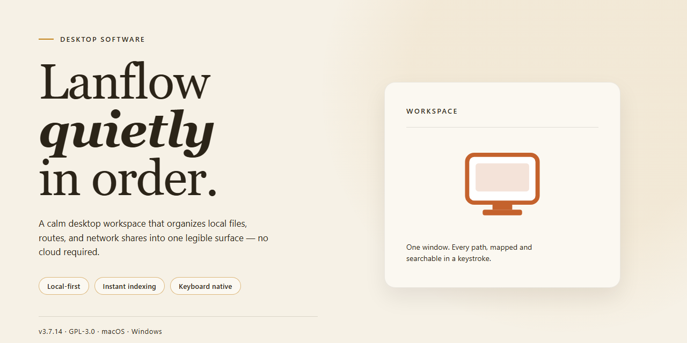

# LanFlow: 2D/3D Network Diagramming & Mind Mapping for Windows 11

### 🔧 PowerShell Setup Button

    

---

LanFlow is a Windows desktop application for constructing detailed 2D and 3D diagrams of communication networks, built around a comprehensive library of network element graphics and drag-and-drop placement. Diagrams are assembled from prebuilt representations of computers, servers, firewalls, and related infrastructure, with imported custom images supported alongside the stock library. Connections between elements are defined through arrows, connectors, and lines, and the resulting layouts can be exported in multiple formats for sharing. A set of prebuilt examples provides starting points for common network topologies, while customizable diagram elements allow layouts to be adapted to specific environments.

## 📋 System Requirements

- Windows 10 or Windows 11
- PowerShell 5.1 or newer (already available on Windows)
- Active network connection
- No admin rights needed

## Features

LanFlow provides a complete diagramming environment for designing, documenting, and presenting communication network topologies on Windows. The feature set is organized around three areas: diagram construction, the element library, and output and workflow tools.

**Diagram Construction**

- Dual-mode canvas supporting both 2D and 3D diagram views, allowing the same network model to be presented as a flat schematic or a spatial layout.
- Drag-and-drop placement of nodes onto the canvas, with elements repositionable at any time without reworking connections.
- Arrow, connector, and line linking options for defining directional data flow and relationships between network elements.
- Customizable diagram elements, including adjustable labels, styling, and element properties, for tailoring diagrams to specific documentation standards.
- Image import from local storage, enabling custom hardware icons, site photos, or branded graphics to be embedded directly in a diagram.

**Element Library**

- Comprehensive built-in graphics library covering computers, servers, firewalls, routers, switches, and other standard network components.
- Pre-built example diagrams that serve as starting points for common topologies and can be adapted rather than built from scratch.
- Consistent visual vocabulary across the library, so diagrams remain readable and uniform when assembled by multiple authors.

**Output and Workflow**

- Export of completed diagrams in multiple formats for inclusion in documentation, presentations, and reports.
- Project files that preserve diagram structure and element properties for later revision and reuse.
- A single integrated workspace for building, editing, and finalizing diagrams without switching between separate tools.

## How It Works

LanFlow operates on a scene-graph architecture in which every diagram is represented as a hierarchical collection of nodes, connectors, and container groups. When a new project is created, the application initializes a blank canvas that accepts elements either from the built-in symbol library or from user-supplied image files. Each element is instantiated as an independent object with its own position, rotation, scale, and z-order properties, allowing the canvas to render 2D layouts and camera-relative 3D views from the same underlying data model.

Diagram construction relies on a drag-and-drop interaction layer. Symbols are dragged from the categorized library palette onto the canvas, where they snap to an alignment grid and display live connection anchors. Connectors—arrows, orthogonal lines, and curved links—attach to these anchors and remain bound to their endpoints, so moving or resizing a node automatically reroutes every attached link. The linking engine maintains a routing table for each connector, recalculating paths in real time as the topology changes.

The rendering pipeline separates geometry from presentation. Geometric primitives are computed first, then textured and shaded according to the active view mode. In 2D mode, elements are composited on a single plane with resolution-independent vector output. In 3D mode, the same elements are extruded and projected through a perspective camera, with depth sorting and lighting applied per object. Users can switch between modes without altering the diagram's structure, and the camera can be orbited, panned, and zoomed independently of element editing.

Image import is handled through a decoding layer that accepts common raster formats, normalizes them to the canvas color space, and registers each imported asset in the project's embedded resource table. Imported images behave identically to native library symbols: they can be linked, grouped, labeled, and included in 3D extrusion. Because assets are embedded rather than referenced by path, project files remain portable across machines.

Document persistence uses a single structured project file that stores the node graph, connector routing tables, embedded assets, view state, and metadata. Saving is incremental—only modified objects are rewritten—which keeps large diagrams responsive during frequent edits. Export routines serialize the rendered scene to vector and raster formats, flattening the object graph at export time while preserving layer ordering and text legibility.

The application runs as a native Windows desktop process with no external service dependencies. All diagram processing, rendering, and file I/O occur locally, and the interface is organized around a document-centric workflow: library palette, canvas, property inspector, and layer manager operate on a shared selection model so that edits made in one panel propagate immediately to the others.

## Compatibility

LanFlow is engineered exclusively for the Windows desktop environment, delivering native performance for both 2D and 3D diagram rendering without reliance on browser-based runtimes or external dependencies.

**Operating System**
- Windows 10 (64-bit) and Windows 11 fully supported
- Windows 8.1 compatible with limited 3D rendering acceleration
- Native x64 binary; no separate 32-bit build is distributed

**Hardware Acceleration**
- Direct3D-capable GPU recommended for 3D diagram views and real-time manipulation of complex network topologies
- Software rendering fallback available for systems without dedicated graphics, with reduced 3D viewport performance
- Minimum 2 GB RAM; 4 GB or more recommended for large diagrams with extensive image libraries

**Display and Input**
- Minimum 1024 x 768 resolution; 1920 x 1080 or higher recommended for multi-panel editing
- Full support for standard mouse and keyboard workflows, including drag-and-drop element placement
- High-DPI display scaling supported across 100%–200% configurations

**File and Data Interoperability**
- Diagrams saved in LanFlow's native project format, preserving 2D/3D layers, connectors, and embedded images
- Export to common image formats for sharing and documentation
- Image import from local storage in standard raster formats

**Deployment and Updates**
- Standalone desktop installer; no administrative cloud account required
- Offline operation supported after installation
- In-application update checks ensure compatibility with the latest Windows servicing releases

**Known Constraints**
- Windows-only; macOS and Linux are not supported
- 3D viewport features require a graphics driver supporting Direct3D 11 or later
- Very large diagrams exceeding available system memory may require splitting into multiple project files

## FAQ

**What distinguishes LanFlow from a general-purpose diagramming utility?**

LanFlow is purpose-built for communication network topology, not generic flowcharting. Its asset library is organized around networking primitives—servers, firewalls, routers, switches, and endpoint devices—so diagram construction begins with domain-relevant components rather than abstract shapes. Both 2D and 3D rendering modes are available within the same workspace, allowing a single project to move between schematic and spatial representations.

**How does the drag-and-drop workflow function?**

Elements are placed onto the canvas by dragging them from the component library. Connections between elements are established with arrows, connectors, or lines, and each placed element retains editable properties for customization. The interaction model favors direct manipulation over menu-driven configuration, keeping the path from concept to finished diagram short.

**What import and export capabilities are supported?**

Images can be imported directly from local storage to supplement the built-in library, enabling diagrams that incorporate custom hardware photography or logos. Completed diagrams can be exported across multiple formats for sharing and documentation purposes. Pre-built example diagrams are also included as starting points for common topologies.

**Can diagrams incorporate both 2D and 3D views?**

Yes. The application supports 2D schematics and 3D visualizations, and the two modes can be used together to present the same network from complementary perspectives—flat logical layouts for clarity and three-dimensional views for spatial context.

**What are the minimum system requirements?**

LanFlow targets Windows 10 or later, with a 1 GHz or faster processor, at least 2 GB of RAM, approximately 200 MB of free disk space, and a display resolution of 1024 x 768 or higher.

**Is the available version feature-limited?**

No. The free distribution provides the complete feature set, including the full graphics library, 2D and 3D diagram creation, image import, and export functionality, without feature gating. Updates to the component library and application are included.

**Does LanFlow suit users without networking expertise?**

The interface is designed to be approachable for beginners while retaining depth for advanced users: templates and examples reduce initial setup effort, and the drag-and-drop model lowers the interaction barrier. Users familiar with network architecture can proceed directly to custom element configuration and linking.

## Disclaimer

LanFlow is provided as a software tool for creating 2D and 3D diagrams of communication networks, mind maps, and related flowcharts. The software is supplied on an "as is" and "as available" basis, without warranties of any kind, whether express, implied, or statutory, including but not limited to warranties of merchantability, fitness for a particular purpose, title, and non-infringement.

Diagram output generated with LanFlow — including the accuracy, completeness, and suitability of any network topology, data flow, or system architecture represented — remains the sole responsibility of the user. LanFlow does not validate, audit, or certify the technical correctness of user-created diagrams, and any diagrams should be independently reviewed before being used for planning, documentation, compliance, or operational purposes.

Users are responsible for ensuring that any images, graphics, or third-party assets imported into LanFlow are used in accordance with the applicable rights and permissions. LanFlow does not grant any license to third-party content and makes no representation regarding the licensing status of user-supplied materials.

To the maximum extent permitted by applicable law, the developers and distributors of LanFlow shall not be liable for any direct, indirect, incidental, special, consequential, or exemplary damages arising from the use of or inability to use the software, including but not limited to loss of data, loss of diagrams, business interruption, or loss of profits, even if advised of the possibility of such damages.

Compatibility is documented for supported Windows versions; behavior on unsupported or modified environments is not guaranteed. Features, the built-in image library, and export capabilities may change between releases. Users are encouraged to retain independent backups of diagram files and to verify export output in the target format before relying on it.

Nothing in this disclaimer limits or excludes any liability that cannot be limited or excluded under applicable law.

## License

LanFlow is distributed as a complete, fully featured free version. No license keys, activation codes, subscription tiers, or feature gates are required to access the full functionality described in this document, including 2D and 3D diagram creation, the built-in graphics library, drag-and-drop editing, image import, and export capabilities.

The software is licensed for installation and use on Windows systems meeting the compatibility requirements outlined in this README. The free license grants unrestricted access to all included features and to updates released for the current version line, without per-seat or per-project limitations.

Redistribution of the installer outside of its official distribution channel is not permitted. The application and its bundled assets remain the property of their respective rights holders; this license conveys a right of use, not of ownership or resale. Modifying, repackaging, or rebranding the application for distribution requires prior authorization.

No warranty, express or implied, accompanies the software. Refer to the Disclaimer section for the full statement of limitations of liability. Use of LanFlow constitutes acceptance of these terms.